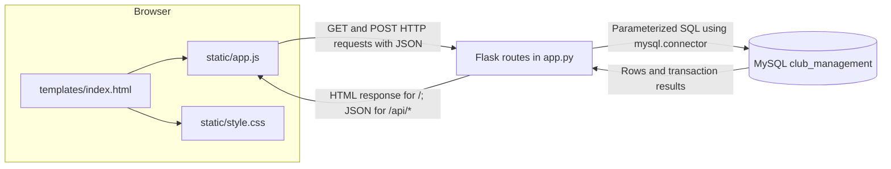
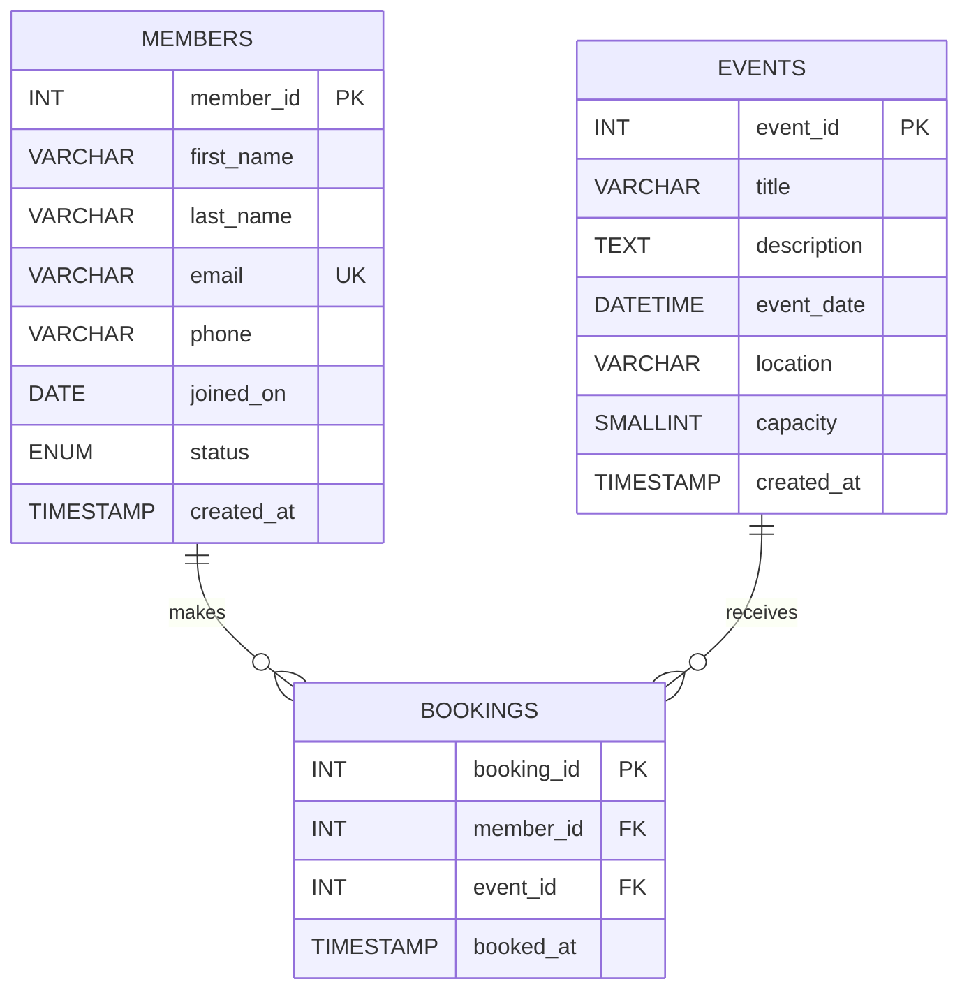

# Club Desk — Project Overview

## 1. Introduction

Club Desk is a small club-management web application. It keeps member, event, and event-booking data in a MySQL database. A Flask application serves the page and exposes JSON endpoints used by browser JavaScript.

The implemented features are:

- Display member names, email addresses, join dates, and active/inactive status.
- Add a member with first name, last name, email, and optional phone.
- Display events, their locations and dates, and their remaining booking capacity.
- Book an active member into an event if seats remain and the member has not already booked it.
- Show summary counts for active members, upcoming events, and all bookings.

The source does not implement event creation/editing, member editing/deletion, booking cancellation, user login, or role permissions.

## 2. Technology stack

| Layer | Technology | Source |
|---|---|---|
| Browser UI | HTML5, CSS, JavaScript | `templates/index.html`, `static/style.css`, `static/app.js` |
| Web server and API | Python, Flask | `app.py`; dependency in `requirements.txt` |
| Database connector | MySQL Connector/Python | `app.py`; dependency in `requirements.txt` |
| Relational database | MySQL 8+ / InnoDB | `schema.sql` |

The project uses Flask's template rendering for `/`, native browser `fetch()` for API calls, and parameterized SQL statements through `mysql.connector`.

## 3. Project folder structure

Generated local folders such as `.venv/` and `__pycache__/` are intentionally excluded from this source tree and from Git by `.gitignore`.

```text
club-management-system/
├── .env.example              # Placeholder connection-variable example; not auto-loaded
├── .gitignore                # Excludes secrets, environments, caches, and local files
├── PROJECT_OVERVIEW.md       # This documentation
├── README.md                 # GitHub landing page and quick start
├── app.py                    # Flask application, API routes, and MySQL access
├── requirements.txt          # Flask and MySQL Connector/Python dependencies
├── schema.sql                # Database, tables, constraints, sample rows, SQL examples
├── static/
│   ├── app.js                # Browser API calls and form behavior
│   └── style.css             # Page styling and responsive layout
└── templates/
    └── index.html            # Server-rendered single-page interface
```

## 4. System architecture



## 5. Database ER diagram

`schema.sql` defines three InnoDB tables. `bookings` is the associative table joining a member to an event.



- `members.member_id`, `events.event_id`, and `bookings.booking_id` are auto-increment primary keys.
- `members.email` is unique.
- `bookings.member_id` references `members.member_id` and `bookings.event_id` references `events.event_id`.
- A unique constraint on `(member_id, event_id)` allows at most one booking for a member at a given event.
- Deleting a member with bookings is restricted; deleting an event cascades to its bookings. Both foreign keys cascade updates.

## 6. Frontend

### `templates/index.html`

Flask's `home()` route renders this page. It provides the element IDs consumed by JavaScript: `memberForm`, `bookingForm`, `membersBody`, `memberSelect`, `eventSelect`, `eventsList`, the summary counters, and the status/error message elements. It loads `static/style.css` and `static/app.js` through Flask's `url_for()`.

### `static/style.css`

Contains the layout, colors, forms, tables, event cards, and responsive rules. It has no database or API behavior.

### `static/app.js`

- `$()` finds page elements; `esc()` escapes values inserted into HTML; `api()` wraps `fetch()` and raises an error for non-success responses.
- `load()` fetches `/api/summary`, `/api/members`, and `/api/events`; then updates counters, the member table, the active-member dropdown, event cards, and the event dropdown. The member dropdown filters the API results to `status === 'active'`; the event dropdown includes events with available seats.
- The `memberForm` submit listener captures the form before the request, sends its fields to `POST /api/members`, resets it only on success, displays a message, and reloads the page data.
- The `bookingForm` submit listener validates that both dropdowns have a selection, sends their IDs to `POST /api/bookings`, displays the returned success/error message, and calls `load()` on success so counts and seats are refreshed.
- The initial `load()` populates the dashboard when the script starts.

## 7. Backend and API

### MySQL connection and query helper

In `app.py`, `get_db()` reads `DB_HOST`, `DB_PORT`, `DB_USER`, `DB_PASSWORD`, and `DB_NAME` from the process environment. Defaults are localhost, port 3306, root, an empty password, and `club_management`. `rows(query, params=())` runs a query with a dictionary cursor, returns its rows, and closes the connection.

### Routes

| Method | Path | Flask function | Behavior |
|---|---|---|---|
| `GET` | `/` | `home()` | Renders `templates/index.html`. |
| `GET` | `/api/summary` | `summary()` | Returns active member count, future event count, and booking count. |
| `GET` | `/api/members` | `list_members()` | Returns member fields ordered by last and first name. |
| `POST` | `/api/members` | `add_member()` | Requires first name, last name, and email; inserts the optional phone; returns the new ID. Duplicate email produces HTTP 409; missing fields produce HTTP 400. |
| `GET` | `/api/events` | `list_events()` | Returns events with booking counts and remaining seats, ordered by date. |
| `POST` | `/api/bookings` | `book_event()` | Accepts `member_id` and `event_id`; checks event capacity, verifies the member is active, inserts the booking, and commits. |

`add_member()` and `book_event()` use `%s` placeholders and parameter tuples for values. `book_event()` returns HTTP 400 for invalid/missing IDs or an inactive/missing member, HTTP 404 for a missing event, and HTTP 409 for a full event or duplicate booking. Successful booking returns HTTP 201 with `{"message":"Booking confirmed."}`.

## 8. How data flows

1. The browser requests `/`; Flask `home()` renders `index.html` and the browser loads its JavaScript and stylesheet.
2. `app.js` calls the three GET APIs concurrently from `load()`.
3. The Flask routes call `rows()` or run their own parameterized SQL using `get_db()` connections.
4. Flask serializes query results as JSON. JavaScript updates the counters, member table, and dropdown/card markup.
5. When a form is submitted, JavaScript prevents normal page navigation and sends JSON to its POST API.
6. Flask validates the request, performs SQL, and returns a JSON result and HTTP status.
7. JavaScript displays the result. After a successful member registration or booking, `load()` retrieves current data again.

## 9. Member registration flow

1. `templates/index.html` defines fields named `first_name`, `last_name`, `email`, and `phone` inside `#memberForm`.
2. In `static/app.js`, the `memberForm` handler creates a form-data object and posts it to `/api/members` as JSON.
3. `add_member()` in `app.py` rejects missing required fields with HTTP 400.
4. It inserts into `members` and commits. The database's unique constraint on `email` prevents duplicate email addresses; the handler maps that integrity error to HTTP 409.
5. On success the browser resets the captured form, shows a confirmation, and calls `load()` to refresh the directory, count, and dropdown.

## 10. Event booking flow and data integrity

1. `load()` builds `#memberSelect` from members whose status is `active`, and `#eventSelect` from events whose remaining-seat count is positive.
2. The browser checks that both choices are selected and posts integer IDs to `/api/bookings`.
3. `book_event()` starts a database transaction. It selects the requested event's capacity with `FOR UPDATE`, locking the event row while the booking capacity check is in progress.
4. It verifies the member exists and has `status='active'`, counts the event's bookings, and rejects the request if the event is full.
5. It inserts the `(member_id, event_id)` pair and commits. On an integrity error or other connector error it rolls back.
6. The unique constraint on the pair is the database-level duplicate-booking prevention, even if duplicate requests reach the server. The route reports this as HTTP 409.
7. After a successful response, the browser calls `load()` to refresh event seat counts and summary values.

## 11. SQL keys and constraints

Defined in `schema.sql`:

- Primary keys on all three tables.
- `uq_members_email` prevents duplicate member emails.
- `chk_members_email` applies a basic email-shape check.
- `chk_events_capacity` requires a capacity greater than zero.
- `uq_booking_member_event` prevents a member from booking the same event twice.
- `fk_bookings_member` and `fk_bookings_event` enforce valid member/event references and define delete/update behavior.
- `idx_events_date` supports event-date lookup; `idx_bookings_event` supports per-event booking counts.
- InnoDB is used so foreign keys and booking transactions are supported.

The SQL file also contains three sample members, three sample events, sample bookings, and commented example queries. Its inserts are written to tolerate re-running against matching primary keys/unique values; do not run it against a database whose existing IDs or emails have different meanings without reviewing the SQL first.

## 12. Installation and execution

### Requirements

- Python 3.10 or newer.
- MySQL 8.0 or newer.

### Setup

1. From the project directory, import the schema and sample data into a local MySQL server:

   ```sh
   mysql -u root -p < schema.sql
   ```

2. Create and activate a virtual environment, then install the listed dependencies:

   ```sh
   python -m venv .venv
   # Windows PowerShell
   .venv\Scripts\Activate.ps1
   # macOS/Linux instead: source .venv/bin/activate
   pip install -r requirements.txt
   ```

3. Configure connection variables in the environment where Flask will run. For example, in PowerShell:

   ```powershell
   $env:DB_HOST = "localhost"
   $env:DB_PORT = "3306"
   $env:DB_USER = "root"
   $env:DB_PASSWORD = "your_local_mysql_password"
   $env:DB_NAME = "club_management"
   ```

   `.env.example` documents these names but is not automatically loaded by `app.py`. Keep real credentials in local environment variables; `.env` and virtual-environment folders are excluded by `.gitignore`.

4. Start the Flask app:

   ```sh
   python app.py
   ```

5. Open <http://127.0.0.1:5000> in a browser. The app uses port 5000 by default through Flask's `app.run()`.

## 13. Scope and deployment note

This project demonstrates database-backed CRUD-adjacent workflows for member creation and event registration. It does not include authentication, authorization, CSRF defenses, event management forms, or production secret-management tooling. Use it locally for learning unless those controls are added before deployment with real member data.
