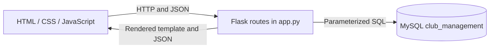

# Club Desk — Club Management System

Club Desk is a small web application for maintaining a club member directory and registering active members for events. It uses Flask for the web server and API, MySQL for persistent data, and a browser interface built with HTML, CSS, and JavaScript.

## Features

- View club members and their active/inactive status.
- Register a member with a unique email address.
- View events with current booking counts and remaining seats.
- Book an active member into an event, subject to capacity and duplicate-booking checks.
- See summary counts for active members, upcoming events, and bookings.

## Architecture



For the detailed architecture, ER diagram, API reference, data flow, and setup guide, see [PROJECT_OVERVIEW.md](PROJECT_OVERVIEW.md).

## Quick start

Requirements: Python 3.10+ and MySQL 8+.

1. Create the schema and sample data:

   ```sh
   mysql -u root -p < schema.sql
   ```

2. Install the Python dependencies in a virtual environment:

   ```sh
   python -m venv .venv
   # Windows PowerShell: .venv\Scripts\Activate.ps1
   # macOS/Linux: source .venv/bin/activate
   pip install -r requirements.txt
   ```

3. Configure the database connection with environment variables (`DB_HOST`, `DB_PORT`, `DB_USER`, `DB_PASSWORD`, and `DB_NAME`). The defaults are in `app.py`; `.env.example` is a reference template and is not automatically loaded.

4. Run the app and open <http://127.0.0.1:5000>:

   ```sh
   python app.py
   ```

## Project files

- `app.py` — Flask routes and MySQL queries.
- `schema.sql` — MySQL database, tables, constraints, indexes, sample data, and example SQL.
- `templates/index.html` — application page structure.
- `static/app.js` — API calls, page updates, member registration, and booking submission.
- `static/style.css` — responsive visual styling.
- `requirements.txt` — Python dependencies.
- `PROJECT_OVERVIEW.md` — detailed source-based project documentation.


